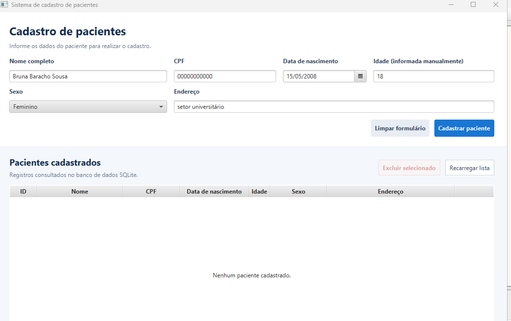

# Sistema de cadastro de pacientes — JavaFX e ORMLite

## Apresentação

Aplicação de computador para cadastrar pacientes e consultar os registros armazenados em um banco de dados SQLite. A interface é desenvolvida em JavaFX e pode ser editada visualmente no Scene Builder. O projeto utiliza ORMLite para a persistência dos dados e separa as responsabilidades seguindo a organização MVC (Model, View e Controller).

**Toda a interface apresentada ao usuário está em português brasileiro.** Os nomes técnicos das bibliotecas e alguns identificadores do código permanecem em sua forma convencional para manter a compatibilidade com JavaFX, ORMLite e o banco de dados.

## Entidade escolhida: Paciente

A entidade `Paciente` possui os seguintes atributos:

- `id`: identificador único gerado automaticamente pelo banco de dados;
- `nome`: nome completo do paciente;
- `cpf`: CPF do paciente;
- `birthday`: data de nascimento, apresentada na interface no formato brasileiro `dd/MM/aaaa`;
- `idade`: idade informada manualmente no formulário;
- `sexo`: opção selecionada no formulário;
- `endereco`: endereço do paciente.

## Funcionalidades implementadas

- **Cadastro (Create):** grava um novo paciente no banco de dados SQLite;
- **Consulta (Retrieve):** apresenta os pacientes cadastrados em uma tabela (`TableView`);
- Atualização da tabela após um cadastro ou exclusão;
- Validação dos campos obrigatórios e da idade;
- Limpeza do formulário;
- Recarregamento da lista de pacientes;
- **Exclusão (Delete — bônus):** remove do banco o paciente selecionado, após uma confirmação do usuário. O botão fica desabilitado enquanto nenhum paciente estiver selecionado.

A atividade exige obrigatoriamente Create e Retrieve. A exclusão foi acrescentada como melhoria opcional (bônus); a atualização (Update) não foi implementada.

## Organização do projeto

| Arquivo | Responsabilidade |
|---|---|
| `Paciente.java` | Modelo da entidade e mapeamento ORMLite. |
| `PacienteView.fxml` | Interface gráfica, editável no Scene Builder. |
| `PacienteController.java` | Controla os eventos, valida os campos e atualiza a tabela. |
| `PacienteRepository.java` | Executa as operações de acesso aos dados. |
| `Database.java` | Gerencia a conexão SQLite e a migração da tabela antiga. |
| `Main.java` | Inicializa a aplicação JavaFX. |
| `hospital.db` | Banco de dados SQLite utilizado pela aplicação. |

## Requisitos para executar

- JDK compatível com a versão do JavaFX configurada;
- JavaFX configurado no BlueJ;
- Scene Builder instalado para visualizar e editar o arquivo FXML;
- Bibliotecas ORMLite JDBC e ORMLite Core;
- Driver JDBC do SQLite (`sqlite-jdbc`).

Os arquivos `.jar` das bibliotecas não estão incluídos neste projeto. Utilize as mesmas bibliotecas e configurações que já funcionam no seu ambiente BlueJ. Caso abra o projeto em outro computador, será necessário configurar essas dependências novamente.

## Como abrir e executar no BlueJ

1. Extraia a pasta do projeto para um local de sua preferência.
2. Abra o BlueJ e selecione **Project (Projeto) > Open Project (Abrir projeto)**.
3. Escolha a pasta extraída que contém o arquivo `package.bluej`.
4. Confira se as bibliotecas ORMLite e SQLite JDBC estão disponíveis para o projeto e se a configuração JavaFX já utilizada no BlueJ continua ativa.
5. Abra `Main.java` e execute o método `main`, ou use a opção de execução da classe `Main` no BlueJ.
6. A janela do sistema será aberta com o formulário e a tabela de pacientes.

## Como editar a interface no Scene Builder

1. Localize o arquivo `PacienteView.fxml` na pasta do projeto.
2. Abra o arquivo com o Scene Builder.
3. É possível alterar textos, cores, tamanhos e disposição dos componentes.
4. **Preserve os valores `fx:id` e os métodos `onAction` existentes**, pois eles conectam os componentes ao `PacienteController.java`.
5. Salve o arquivo FXML e execute novamente a classe `Main` no BlueJ.

## Banco de dados e migração

A versão anterior do projeto utilizava a idade como identificador automático e não possuía uma coluna `id` separada. Nesta versão, o identificador é armazenado em `id`, enquanto a idade continua sendo informada manualmente.

Na inicialização, `Database.java` verifica se a tabela antiga ainda não possui a coluna `id`. Quando necessário, a estrutura da tabela é atualizada e os dados existentes são copiados para a nova estrutura. Se a tabela já estiver atualizada, a migração não é repetida.

**Antes da primeira execução, mantenha uma cópia de segurança do arquivo `hospital.db`.** A migração deve ser testada primeiro em uma cópia do banco original.

O arquivo `hospital.db` deve estar no diretório de trabalho utilizado pelo BlueJ ao executar a aplicação. Se o BlueJ iniciar o programa em outro diretório, ajuste o caminho informado em `new Database("hospital.db")` no `PacienteController.java`.

## Testes recomendados

1. Execute a aplicação e confira se a tabela apresenta os registros existentes.
2. Preencha os campos do formulário e cadastre um paciente.
3. Confira se o paciente aparece na tabela com um identificador gerado automaticamente.
4. Feche e abra a aplicação novamente e verifique se o registro continua na tabela.
5. Experimente deixar um campo obrigatório vazio e informar uma idade inválida para conferir as mensagens de validação.

## Capturas de tela para a entrega

Adicione à pasta `screenshots/` capturas reais da aplicação executada no BlueJ. Sugestões:

- `screenshots/tela-principal.png`: formulário e tabela;
- `screenshots/paciente-cadastrado.png`: tabela após realizar um cadastro;
- `screenshots/exclusao-paciente.png`: tabela após excluir um paciente.

Para inserir uma captura neste documento, utilize, por exemplo:

```markdown

```

## Autoria

Projeto acadêmico desenvolvido para a atividade prática de Java/Programação Orientada a Objetos.
